  

# 🌐 Awesome High Availability & Test Grid Failover

### 🚀 Production-Grade DNS Failover, Global Server Load Balancing (GSLB) & Chaos-Validated Resilience

**Curated Directory of Enterprise SaaS Traffic Controllers & Open-Source Cloud-Native Failover Projects**  
*Comprehensive resource for SREs, DevOps engineers, and distributed test grid architects.*  
**Last updated: March 2026**

---

## 📑 Table of Contents

- [🎯 Overview & Architecture](#-overview--architecture)
- [📊 Sector Overview & Market Dynamics](#-sector-overview--market-dynamics)
- [☁️ SaaS & Hosted Global Traffic Management Platforms](#️-saas--hosted-global-traffic-management-platforms)
- [🛠️ Open-Source GitHub Projects](#️-open-source-github-projects)
  - [🌟 Featured Category Leaders](#-featured-category-leaders)
  - [⚡ Ingress, Edge & Load Balancing Proxies](#-ingress-edge--load-balancing-proxies)
  - [💥 Chaos Engineering & Failover Verification Grids](#-chaos-engineering--failover-verification-grids)
- [🤝 How to Contribute](#-how-to-contribute)
- [💖 Support & Community](#-support--community)
- [📈 Star History](#-star-history)
- [⚖️ Disclaimer](#️-disclaimer)

---

## 🎯 Overview & Architecture

High availability (HA) and automated failover are critical requirements for mission-critical production systems and distributed test grids. In testing infrastructure and multi-region microservices, the grid must withstand region outages, transient network partitions, datacenter disasters, and load spikes without service interruption.

This repository tracks **enterprise SaaS platforms** and **open-source implementations** across:
1. **Global Server Load Balancing (GSLB)**: Directing requests to closest or healthiest data centers.
2. **DNS-Based Failover**: Dynamic record switching, health checking, and latency steering.
3. **Anycast Routing & VIP Failover**: Fast layer 3/4 and layer 7 traffic redirection.
4. **Chaos Engineering Grids**: Fault-injection testing frameworks that actively simulate node and network failures to prove automated failover behavior works before production disasters occur.

---

## 📊 Sector Overview & Market Dynamics

The Global Server Load Balancing (GSLB) and Application Delivery Controller (ADC) market is valued at approximately **$8.1B to $9.4B in 2026** (scaling toward >$25B by 2034 at a ~14% CAGR), while the Managed DNS & Traffic Steering market commands **$2.1B to $3.2B**. 

Market dynamics demonstrate a **highly concentrated, winner-take-most structure** at the cloud and global edge layers—dominated by hyperscalers (Microsoft, Alphabet, Amazon) and specialized edge networks (Cloudflare)—while the self-hosted and Kubernetes-native infrastructure tier is **moderately fragmented**, fostering innovative open-source CNCF projects for vendor-agnostic multi-cloud resilience.

---

## ☁️ SaaS & Hosted Global Traffic Management Platforms

The following hosted platforms provide managed DNS failover, global health checks, and intelligent traffic steering. Sorted in descending order by parent company market capitalization / valuation:

| Product | Valuation / Revenue | Description | Pricing (Starting) | Free Tier / Trial Limits |
|:---|:---|:---|:---|:---|
| **[Azure Traffic Manager](https://azure.microsoft.com/en-us/products/traffic-manager/)** | **~$3.89 Trillion** *(Microsoft)* | 🌐 DNS-based traffic distribution with priority, weighted, performance, and geographic routing methods. Health checks monitor endpoint availability and automatically fail over across regions. | $0.54 per million DNS queries (first 1B queries/mo, then $0.375/M); $0.36/month per basic Azure endpoint health check ($0.54/mo per external endpoint) | 30-day free trial with $200 Azure credit applicable to all Traffic Manager resources; no perpetual free tier after credit exhaustion |
| **[Google Cloud Load Balancing](https://cloud.google.com/load-balancing)** | **~$3.60 Trillion** *(Alphabet)* | 🌍 Global external and internal load balancing with cross-region failover, Anycast single virtual IP, and distributed health probes. | $0.025/hour for the first 1–5 forwarding rules (~$18.25/month flat) + $0.010/hour per additional rule + $0.008 to $0.012 per GB data processed | 90-day free trial with $300 GCP credit usable toward forwarding rules and egress; no permanent free tier for load balancer forwarding rules |
| **[AWS Route 53](https://aws.amazon.com/route53/)** | **~$2.88 Trillion** *(Amazon)* | 🛡️ **The benchmark for DNS-based failover.** Distributed health checkers aggregate responses—if over 18% report healthy, the endpoint remains active; 18% or fewer triggers automated failover. Supports latency-based, geo-proximity, and multi-value routing. | $0.50/month per hosted zone (first 25 zones); $0.40 per million standard queries; $0.50/month per basic AWS health check ($0.75/month for non-AWS) | First 50 health checks for AWS endpoints are free forever; alias queries to AWS resources (ALB/CloudFront/S3) are free; external queries and hosted zones have no free tier (billed from day 1) |
| **[NS1 Traffic Steering](https://ns1.com/)** | **~$233.5 Billion** *(IBM)* | ⚡ Enterprise DNS with advanced filter chain traffic steering, real-time telemetry monitoring, and 100% uptime SLA. Built for automated DevOps workflows. | $99.00/month (Essentials Plan) or $349.00/month (Standard Plan with full traffic steering & filter chains) | Free Developer Tier permanently includes up to 5M queries/month, 500 records, 1 monitor, and 1 filter chain; 30-day enterprise free trial provides up to 50M queries, 500 records, and 20 monitors |
| **[Cloudflare Load Balancing](https://www.cloudflare.com/)** | **~$109.5 Billion** *(Cloudflare)* | 🛰️ Global server load balancing with granular health checks, geo-steering, and automatic failover across origin pools, backed by Cloudflare's Anycast edge and DDoS shield. | $5.00/month base subscription (includes 2 origin pools) + $0.50 per additional 500k queries over free allocation | First 500,000 DNS queries/month included free; unmetered DDoS mitigation & basic Anycast DNS free forever on Cloudflare Free plan (Load Balancing add-on requires min. $5/mo) |
| **[F5 BIG-IP DNS](https://www.f5.com/)** | **~$17.8 Billion** *(F5 Inc.)* | 🏢 Carrier-grade enterprise GSLB with Wide IPs, hyperscale global availability, and comprehensive multi-cloud/datacenter failover management. | PAYG cloud marketplace hourly software license starting at ~$0.25 to $0.50/hour (~$180–$360/month via "Better" bundle at 25 Mbps tier) plus VM compute costs | 30-day free trial available via AWS and Azure Marketplace PAYG listings with full BIG-IP DNS features; no perpetual free tier |

---

## 🛠️ Open-Source GitHub Projects

Open-source resilience tools provide transparent failover orchestration, multi-cluster federation, and chaos validation without query-based SaaS metering.

Every repository is ranked below in **descending order by GitHub star count**.

| Project | Star Badge | Description |
|:---|:---|:---|
| **[CoreDNS](https://github.com/coredns/coredns)** |  | 🔌 **CNCF graduated DNS server** written in Go with plugin-based architecture. Serves as Kubernetes default DNS; powers custom failover plugins, fallback routing, and upstream health checking. |
| **[Higress](https://github.com/alibaba/higress)** |  | ⛩️ **Next-generation cloud-native AI & API gateway** built on Envoy and Istio. Provides multi-cluster high-availability routing, cross-region failover, circuit breaking, and active health checks. |
| **[Chaos Mesh](https://github.com/chaos-mesh/chaos-mesh)** |  | 💥 **CNCF incubating cloud-native chaos engineering platform.** Injects pod failures, network delays, packet loss, and DNS chaos (`k8s_dns_chaos`) to validate automated failover routines in Kubernetes test grids. |
| **[HAProxy](https://github.com/haproxy/haproxy)** |  | ⚡ **The gold standard high-performance TCP/HTTP load balancer and proxy.** Provides ultra-low latency health checking, backup server failover pools, graceful degradation, and seamless hitless reloads. |
| **[LitmusChaos](https://github.com/litmuschaos/litmus)** |  | 🧪 **CNCF incubating chaos engineering orchestrator.** Features an extensive ChaosHub of experiments to simulate cluster failures, node cordons, and network partitions to verify resilient grid failover. |
| **[Keepalived](https://github.com/acassen/keepalived)** |  | 🔄 **Industry-standard routing software for load balancing and high-availability.** Implements the VRRP (Virtual Router Redundancy Protocol) to maintain floating IP addresses and failover between active/passive nodes. |
| **[PowerDNS (dnsdist)](https://github.com/PowerDNS/pdns)** |  | 📡 **Highly configurable, multi-protocol DNS load balancer and dynamic router.** Features health checking, dynamic failover across upstream DNS pools, DoH/DoT support, and Lua-programmable routing rules. |
| **[K8gb](https://github.com/k8gb-io/k8gb)** |  | 🌐 **CNCF incubating Kubernetes-native Global Server Load Balancing solution.** Automates multi-cluster and multi-region failover via CRDs, CoreDNS, and ExternalDNS without proprietary GSLB appliances. |
| **[Apache Traffic Control](https://github.com/apache/trafficcontrol)** |  | 🚦 **Open-source CDN and global traffic control architecture.** Powers global server load balancing, health monitoring, and DNS/HTTP routing for high-throughput distributed edge grids. |
| **[Rota](https://github.com/alpkeskin/rota)** |  | 🔀 **High-performance self-hosted proxy rotator with health checks and failover.** Go-based proxy pool manager that continuously purges unhealthy endpoints and balances testing traffic across pools. |
| **[RouteDNS](https://github.com/folbricht/routedns)** |  | 🛡️ **DNS stub resolver, proxy, and router with failover logic.** Supports DoT, DoH, DoQ, and traditional DNS with programmable upstream routing, round-robin, and fallback groups. |
| **[Krkn](https://github.com/krkn-chaos/krkn)** |  | 🐙 **CNCF sandbox chaos tool for validating Kubernetes failover behavior.** Injects node kills, network partitions, and zone disconnects to verify that test grids automatically shift traffic. |

---

## 🤝 How to Contribute

Contributions are welcome! Help maintain this curated list by following these steps:

1. 🍴 **Fork** this repository.
2. 🌿 Create a feature branch: `git checkout -b feature/add-new-tool`.
3. 📝 Add your tool in either the SaaS or Open-Source section following the existing table formatting and star ranking.
4. 🔗 Ensure all links, descriptions, and metrics are verified and accurate.
5. 🚀 Submit a **Pull Request** with a concise description of why the tool is suitable.

---

## 💖 Support & Community

If you find this repository helpful for architecting resilient grids or evaluating failover tools, please consider supporting the project:

- ⭐ **Star this repository** to help others discover it.
- 🍴 **Fork and contribute** new tools and updates.
- 📢 **Share** with your DevOps, SRE, and QA engineering networks.
- ☕ **Buy a Coffee / Sponsor**: Support ongoing maintenance through the [GitHub Sponsor Dashboard](https://github.com/sponsors/ishandutta2007).

---

## 📈 Star History

---

## ⚖️ Disclaimer

- This is a community-curated directory intended for research, architectural evaluation, and testing. It does not constitute commercial endorsement.
- High availability and failover architectures are safety-critical. A misconfigured health check or flapping timeout can inadvertently cause cascade outages or split-brain scenarios. Always thoroughly test failover mechanisms using chaos engineering tools in isolated staging environments before deploying to production.
- Always verify current pricing, quotas, and SLAs with vendors directly prior to enterprise commitment.

---

**Built with ❤️ for Site Reliability Engineers, Platform Teams & Cloud Architects.**  
*Make resilience testable, provable, and observable.*

